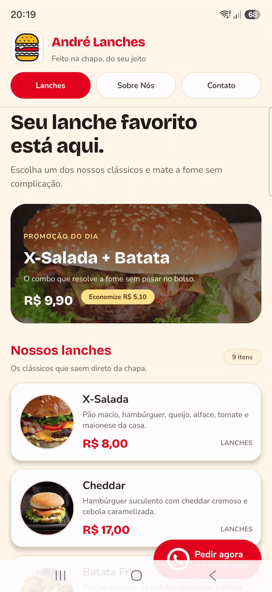

# André Lanches 🍔

Versão mobile do site do **André Lanches**, feita com Expo + React Native + TypeScript.
A ideia foi pegar o site estático original e deixar tudo com cara de app: navegação por abas, cardápio em cards, tela de contato funcional e aquele botão de pedido sempre à mão.

## O que tem dentro

- **Lanches** — cardápio com lanches, porções e bebidas, imagem, descrição e preço.
- **Sobre Nós** — a história (inventada com carinho) da lanchonete.
- **Contato** — formulário com nome, e-mail/WhatsApp e mensagem, com `Alert` de confirmação.
- **Entrega Flutuante** — botão fixo que abre o discador via `Linking.openURL('tel:...')`.
- **Banner de promoção** — componente reutilizável, com título, descrição e preço por props.

## Stack

| Coisa | Versão |
| --- | --- |
| Expo | ~58 |
| React Native | 0.88 |
| React | 19 |
| TypeScript | ~6 |

Fontes: Bricolage Grotesque + Nunito Sans (via `@expo-google-fonts`).

## Rodando

```bash
npm install
npm start
```

Aí é só escanear o QR Code no Expo Go (ou apertar `a` / `i` / `w` para Android, iOS e web).

Outros scripts:

```bash
npm run android      # expo start --android
npm run ios          # expo start --ios
npm run web          # expo start --web
npm run export:web   # exporta a build web pra dist/
npm run preview:web  # exporta + copia o preview.html
npm run preview:serve # serve dist/ em http://localhost:8080
```

## Estrutura

```
App.tsx                  # raiz: SafeAreaView, fontes, troca de telas via estado
src/
  components/            # Header, BannerPromocao, ListaProdutos, SobreNos, Contato, EntregaFlutuante
  data/                  # cardápio e dados de contato
  styles/                # tema (cores, espaçamento), fontes e estilos
  assets/                # imagens dos produtos
  types.ts
```

## Trocar o telefone

Os números ficam em `src/data/restaurant.ts`:

```ts
export const TELEFONE_EXIBICAO = '(11) 99999-9999';
export const TELEFONE_DIAL = '+5511999999999';
```

## Preview

Tem um print da tela em `docs/preview.png`.
E um GIF exemplo do aplicativo funcional
*(Gravado no Samsung Galaxy A37, pode variar conforme.)




---

Projeto acadêmico — o conteúdo original veio do site estático em HTML/CSS (`Site Lanches/`).
